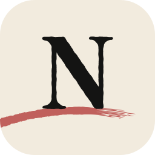
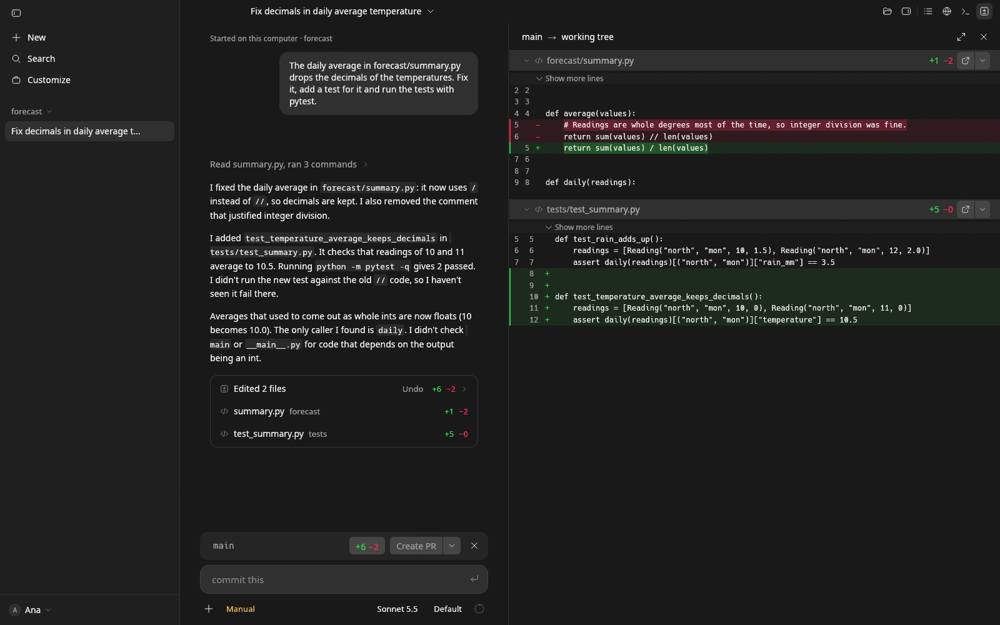
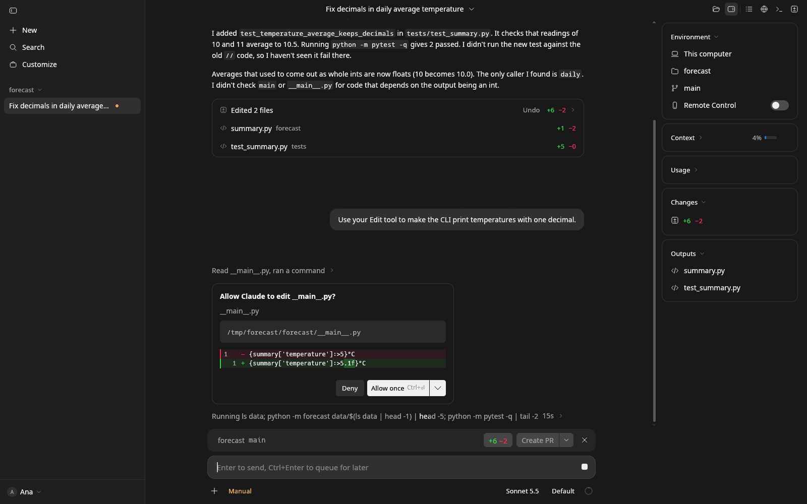
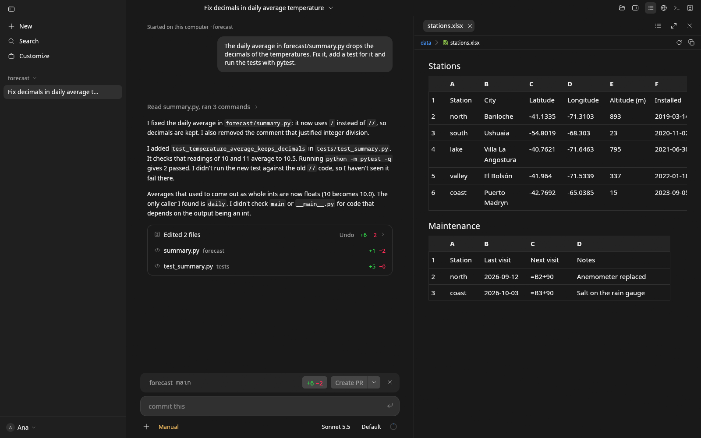

<div align="center">

<picture>
  <source media="(prefers-color-scheme: dark)" srcset="apps/newen/assets/icons/newen-dark-256.png">
  
</picture>

# Newen

**A native desktop app for working with coding agents (Claude Code, Codex,
OpenCode and Hermes Agent), written in Rust and drawn with
[limn](https://github.com/Niiihuel/limn). No Electron.**

[](https://github.com/Niiihuel/newen/releases/latest)
[](https://github.com/Niiihuel/newen/actions/workflows/check.yml)
[](#license)
[](Cargo.toml)
[](#download-and-install)
[](https://github.com/sponsors/Niiihuel)

[Download](https://github.com/Niiihuel/newen/releases/latest) ·
[Features](#features) ·
[Install](#download-and-install) ·
[Build](#build-from-source)

</div>

> [!NOTE]
> **Newen is an independent, personal project. It is not affiliated with,
> endorsed or sponsored by Anthropic, OpenAI, OpenCode or Nous Research.**
>
> It drives the agent programs you install and sign in to yourself, through
> their own command-line interfaces, and presents itself as Newen, never as
> another client. It uses none of their code, fonts or branding; an agent's
> logo appears only to name that agent where Newen lists them.

## Contents

- [What it is](#what-it-is)
- [Screenshots](#screenshots)
- [Features](#features)
- [newen-ide](#newen-ide)
- [Download and install](#download-and-install)
- [Build from source](#build-from-source)
- [Privacy and security](#privacy-and-security)
- [Contributing](#contributing)
- [License](#license)
- [Support the project](#support-the-project)

## What it is

Newen is one place to work with coding agents, whichever company makes them.
You pick an agent's program, open a folder, and talk to it in a session; Newen
shows what it does as it does it: each tool it runs, each command, each
permission it asks for, and each file it creates, changes or deletes.

It is a native program: two Rust executables (Newen and its editor,
newen-ide) whose whole interface is drawn by
[limn](https://github.com/Niiihuel/limn) on the GPU (wgpu). The one browser
inside is the built-in one, Chromium (CEF), for the pages you and the agents
open, never for Newen's own interface.

The architecture does not depend on any agent: everything outside the
`newen-agent-<id>` adapters speaks to an *agent* and knows nothing about who
makes it. Each adapter speaks its program's own protocol:

| Agent | Program | How Newen speaks to it |
| --- | --- | --- |
| **Claude Code** | `claude` | stream-json over stdin and stdout, with its control protocol |
| **Codex** | `codex` | its app server (`codex app-server`, JSON-RPC) |
| **OpenCode** | `opencode` | the Agent Client Protocol (`opencode acp`) |
| **Hermes Agent** | `hermes` | the Agent Client Protocol (`hermes acp`) |

Every adapter offers the agent Newen's own tools, so sessions of different
agents can start, read, message, list and wait for each other: a Claude Code
session can hand part of the work to Codex and pick up its answer.

## Screenshots

<p align="center">
  
</p>
<p align="center">
  
  
</p>

<sub>Newen 0.2.3 at 1600×1000 with Claude Code (Sonnet 5.5) working on a small
sample project; the person's name is a placeholder.</sub>

## Features

- 🤖 **Agents**: Claude Code, Codex, OpenCode and Hermes Agent, each signed
  in with its own program. The model, effort and permission-mode pickers are
  built from what each agent says it offers; OpenCode's model providers are
  connected from Settings, with a key or by signing in, and its models are
  grouped by provider.
- 🧵 **Sessions**: local sessions in any folder, resumed after a restart; a
  sidebar with search, pins and archive (sessions idle for a while can archive
  themselves); fork, rewind, plan mode, messages queued for later, and
  sessions continued from another device where the agent supports it.
- 🔍 **What changed**: a record of each request's created, modified, deleted
  and renamed files, kept in a shadow git repository so it works the same with
  every agent; a diff panel, the changes of the turn on a card, the branch,
  Create PR, and archiving a session once its pull request merges.
- 🛡️ **Permissions**: what an agent asks to do, on a card in the
  conversation, allowed once or always, or denied; and each agent's
  permission modes.
- 🗂️ **Files**: a tree with tabs and an editor beside the chat, Markdown
  rendered, and spreadsheets and Word documents (xlsx, xlsm, xls, xlsb, ods,
  docx, doc) read as tables and text.
- 🖥️ **Terminal and browser**: terminals in tabs, and a built-in browser
  with a separate context per session, which the agents can drive too.
- 🔌 **Connectors, skills and plugins**: MCP connectors for one agent or for
  all of them, a directory to find them, each with its logo; each agent's
  skills and plugins in one Customize page; and a card when a connector you
  have not connected could help with what you asked.
- 🔔 **Desktop**: notifications with Newen's own sounds, open at login, keep
  the computer awake while agents work, read a reply aloud, and open a folder
  in newen-ide or the editor you use.
- 💾 **Storage**: Settings → Storage (or `/storage`) shows what Newen keeps on
  your computer and frees what no longer serves: old sessions, unused file
  history and worktrees, caches.
- ⚙️ **Under the hood**: every state change is written to SQLite before the
  interface sees it, nothing blocking runs on the interface thread, and
  updates come with a manifest signed with Ed25519, file by file, with a
  "What's new" for each version.

What's new in each version is in its
[release notes](https://github.com/Niiihuel/newen/releases).

## newen-ide


`newen-ide` is a second, separate program: a code reader and editor in
Newen's look, keyboard first, with limn's Vim mode. Files open in Normal mode,
to read; `i` writes and Ctrl+S saves. What an agent writes to an open file
shows within a second, unless you have changes of your own there, which stay
until you choose.

- **Moving around**: Ctrl+P opens a file by name, `:42` goes to a line, `/`
  finds in the file, Ctrl+Shift+F finds in every file, and Ctrl+Shift+E walks
  the tree with `j k h l`.
- **Editing**: Alt+Up/Down moves lines, Shift+Alt+Up/Down duplicates them,
  Ctrl+Alt+Up/Down adds a caret, Ctrl+/ comments.
- **Language servers** on your `PATH` (rust-analyzer,
  typescript-language-server, pyright, taplo…): diagnostics, go to definition
  (F12), references (Shift+F12), rename (F2), format, hover and completion.
- **With Newen**: Ctrl+L sends the selection, or the file, to the session of
  that folder for you to ask about; Newen's changes and tool cards open files
  in it.

```sh
newen-ide [folder | file]      # or: newen-ide folder file:line[:column]
```

## Download and install

Releases are published on
[GitHub Releases](https://github.com/Niiihuel/newen/releases/latest). Each one
carries the Linux bundle (`newen-x86_64-linux.tar.gz`), the Windows bundle
(`newen-x86_64-windows.zip`), and the update manifest Newen reads
(`newen-update.json`), signed with Ed25519 (`newen-update.json.sig`). Each
bundle holds Newen, newen-ide and Chromium's (CEF's) files beside them.

**Before you start**: install at least one agent and sign in with it in a
terminal (`claude`, `codex`, `opencode` or `hermes`), and have `git`. Newen
finds the agents on your `PATH`, and with none installed it shows how to
install each one.

### Linux (x86_64)

Built on Ubuntu 24.04, so it needs glibc 2.39 or newer, Wayland or X11,
libxkbcommon, libgbm and a GPU with Vulkan or OpenGL. The archive has no
folder of its own, so unpack it into one:

```sh
mkdir newen && tar -xzf newen-x86_64-linux.tar.gz -C newen
./newen/newen --install
```

`--install` installs it for your user, without administrator rights, in
`~/.local/share/newen/app`. Installed this way, Newen checks for updates (this
can be turned off in Settings), downloads them in the background, verifies
their signature with the keys compiled into it, and installs them when you
relaunch. It does not add a launcher yet: start it with
`~/.local/share/newen/app/current/newen`, or link it onto your `PATH`:

```sh
ln -s ~/.local/share/newen/app/current/newen ~/.local/bin/newen
```

From a source checkout, `scripts/install-desktop.sh` adds Newen's icon and an
entry in the applications menu. A copy run without `--install` works, but does
not update itself.

### Windows (x86_64)

> [!WARNING]
> The Windows bundle is built and checked by CI, but has not been run on a
> Windows machine yet. Expect rough edges, and please
> [open an issue](https://github.com/Niiihuel/newen/issues) with what fails.

Unzip `newen-x86_64-windows.zip` into a folder and run `newen.exe --install`
from it. It installs for your user, without administrator rights, in
`%LOCALAPPDATA%\Programs\newen`, and updates itself from there.

### macOS

Not published yet: the macOS bundle needs to be signed and notarized first.

## Build from source

Newen is built with Rust 1.99.1 (the minimum is 1.99) and depends on
[limn](https://github.com/Niiihuel/limn) by path: clone limn's
`quill/integration` branch beside Newen, as `limn-quill-integration`
([docs/LIMN_INTEGRATION.md](docs/LIMN_INTEGRATION.md) says why):

```sh
git clone https://github.com/Niiihuel/newen
git clone -b quill/integration https://github.com/Niiihuel/limn limn-quill-integration
```

On **Ubuntu 24.04 or Debian**, the packages the
[release](.github/workflows/package.yml) installs:

```sh
sudo apt-get install cmake ninja-build pkg-config clang libclang-dev \
  libwayland-dev libxkbcommon-dev libgbm-dev
```

On **Arch Linux or CachyOS**, the equivalent packages:

```sh
sudo pacman -S --needed cmake ninja pkgconf clang wayland libxkbcommon mesa
```

On **NixOS**, [`shell.nix`](shell.nix) brings everything, CEF included. Then:

```sh
cd newen
cargo run -p newen          # Newen
cargo run -p newen-ide      # the editor
```

The first build downloads CEF (Chromium Embedded Framework), unless
`CEF_PATH` names a copy already there.

**Checks** (the same as CI, before every commit):

```sh
scripts/check.sh            # rustfmt on Newen's files, clippy -D warnings, tests
```

Do not run `cargo fmt --all`: it would reformat limn too, a path dependency.

## Privacy and security

- **Credentials**: each agent signs in with its own program, and Newen never
  sees or stores its tokens. Secrets of the MCP connectors you add are kept in
  the system keyring (Secret Service on Linux, Credential Manager on Windows),
  never in files.
- **No telemetry**: Newen sends nothing about you or your work anywhere. On
  its own, it only reaches GitHub (its updates, and your GitHub account if you
  connect it), the MCP registry (the connectors' directory), svgl.app and the
  servers' own sites for connector and provider logos (switched off in
  Settings), and, if you turn on videos in "What's new", Cisco for the
  OpenH264 codec. What you ask an agent goes to that agent's provider, as it
  would from a terminal.
- **Your files**: Newen keeps its data in `~/.local/share/newen` (on Windows,
  `%LOCALAPPDATA%\newen`), and the file history it records lives in a shadow
  repository there, never in your project's own git.
- **The built-in browser** keeps each session's cookies apart, and the sites
  an agent may use without asking are yours to list in Settings.
- **Updates**: each version's manifest is signed with Ed25519, and Newen
  checks it, and every file it names, against the keys compiled into it
  before installing anything.

## Contributing

The project's rules are in [AGENTS.md](AGENTS.md), and apply to people and
agents alike. In short:

- The whole interface is limn. If limn is missing something, it is
  implemented in [limn](https://github.com/Niiihuel/limn) with its own pull
  request; Newen never carries a copy or a patch of a limn component.
- Agents are adapters: generic code never names a vendor, and every adapter
  offers all of Newen's own tools, with a test that it does.
- Layers only depend downwards (the interface and the engine meet in
  `newen-model`), nothing blocking runs on the interface thread, and an
  important change is stored before the interface sees it.
- A new dependency carries a comment saying why.
- Before a commit: `scripts/check.sh`.

The design documents ([spec](docs/spec.md), [interface](docs/ui.md),
[engine](docs/engine.md), [agents](docs/agents.md),
[updates](docs/UPDATES.md)…) are in Spanish.

## License

Newen's code is under **MIT or Apache-2.0**, at your option:
[LICENSE-MIT](LICENSE-MIT) and [LICENSE-APACHE](LICENSE-APACHE). The
third-party software it uses is listed, with its licenses, in
**Settings → System → Licenses**; [licenses/openh264](licenses/openh264)
holds the notice of Cisco's OpenH264 codec, which Newen downloads only if you
turn on videos in "What's new".

Each agent's logo, shipped with its adapter only to name that agent, belongs
to its owner and is not under Newen's license. The logos of connectors and
providers are not shipped: Newen looks them up when it shows them.

## Support the project

If Newen is useful to you, you can support it through
[GitHub Sponsors](https://github.com/sponsors/Niiihuel) 💜. Opening an issue
with what fails or what's missing helps too.
